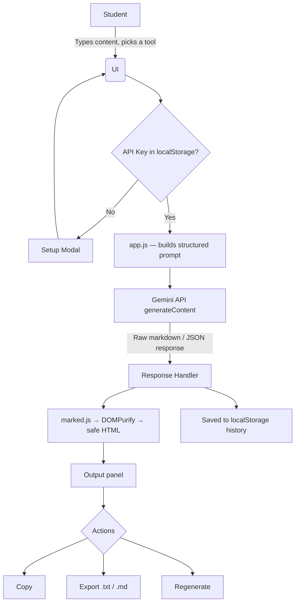

<div align="center">

---

## 📋 Table of Contents

- [About](#-about)
- [Features](#-features)
- [Tech Stack](#-tech-stack)
- [Architecture](#-architecture)
- [Getting Started](#-getting-started)
- [Deploying It Live](#-deploying-it-live)
- [Project Structure](#-project-structure)
- [Input Validation](#-input-validation)
- [Security Note](#-security-note)
- [Screenshots](#-screenshots)
- [Roadmap](#-roadmap)
- [Credits](#-credits)

---

## 📖 About

**SapientStudy-AI** is a FlyRank AI Internship project built to demonstrate real, practical LLM API integration — not a generic chatbot, but a focused set of study tools that solve an actual student problem: turning raw, unstructured material (notes, rough answers, half-formed questions) into something study-ready in one click.

Every tool sends a **structured, purpose-built prompt** to Google's Gemini API — with a defined role, task, and output format — rather than forwarding the user's raw text. That's the core prompt-engineering idea behind this project.

---

## ✨ Features

| Tool                          | What it does                                                                                        |
| ----------------------------- | --------------------------------------------------------------------------------------------------- |
| 📝**Note Summarizer**   | Condenses long, messy notes into clear, structured bullet points                                    |
| 💡**Concept Explainer** | Explains any topic at your chosen level — ELI5, Standard, or Advanced — with a real-world example |
| 🎯**Quiz Generator**    | Turns your notes into a 3-question multiple-choice quiz, with an answer key                         |
| ✍️**Answer Improver** | Reviews a draft answer, gives feedback, and rewrites it clearly                                     |
| 📅**Schedule Maker**    | Builds a realistic day-by-day or hour-by-hour study timetable from your topics and time constraints |
| 🗂️**Flashcard Maker** | Generates 6 flip-style Q&A flashcards from any notes — click to flip                               |

**Also included:** dark/light theme, generation history with search + pin, one-click copy, export as `.txt` or `.md`, a regenerate button, keyboard shortcut (`Ctrl/Cmd + Enter`), and a configurable model selector.

You can also upload text-based PDF, DOCX, TXT, and Markdown (`.md`) files in any feature. Extracted text is added to the content box, where you can review or edit it before generating. Scanned/image-only PDFs are not supported.

---

## 🎨 Design

A neo-brutalist visual style: bold 2.5px borders, hard offset drop-shadows instead of blur, a warm cream background with a subtle dot-grid texture, `Space Grotesk` display type, and six distinct accent colors — one per tool. Feature tiles sit in a horizontal row and visually "press in" when selected. Dark mode is available as a full alternate palette via the settings drawer.

---

## 🛠 Tech Stack

- **Frontend:** HTML5, CSS3, vanilla JavaScript — zero build step, zero dependencies to install
- **AI:** Google Gemini API (`generateContent`), called directly from the browser
- **Libraries (via CDN):** [`marked.js`](https://github.com/markedjs/marked) for markdown rendering, [`DOMPurify`](https://github.com/cure53/DOMPurify) for sanitizing that output before it's displayed, [`PDF.js`](https://mozilla.github.io/pdf.js/) and [`Mammoth.js`](https://github.com/mwilliamson/mammoth.js) for document text extraction, and [Boxicons](https://boxicons.com/) for icons

---

## 🔄 Architecture



---

## ⚡ Getting Started

Because this is fully client-side, all you need is a local static server (opening `index.html` directly via `file://` won't work — the browser blocks the API request due to CORS).

```bash
# From inside the project folder:

# Option A — Python
python -m http.server 8000

# Option B — Node.js
npx serve .
```

Then open **http://localhost:8000** in your browser. On first load, you'll be asked for a Gemini API key — grab a free one at [Google AI Studio](https://aistudio.google.com/).

---

## 🌐 Deploying to Vercel

This is a static HTML/CSS/JavaScript app with no `package.json`, build step, or backend. Deploy it by importing the GitHub repository into Vercel:

1. Sign in to [Vercel](https://vercel.com/) and choose **Add New → Project**.
2. Import [`TariqShahnawaz/SapientStudy-AI`](https://github.com/TariqShahnawaz/SapientStudy-AI).
3. Keep the project root as the **Root Directory** and select **Other** as the Framework Preset.
4. Leave the **Install Command** and **Build Command** empty. Set the **Output Directory** to `.` (the repository root, where `index.html` is located).
5. Select **Deploy**. Vercel will provide a public `*.vercel.app` URL when deployment completes.

No environment variables are required. Do not add a Gemini API key to Vercel: each user enters their own key in the app, which is stored in that user's browser and sent directly to Google's Gemini API.

After connecting the repository, Vercel automatically creates a deployment for pushes to the production branch and preview deployments for pull requests. To roll back, use **Deployments** in the Vercel dashboard to promote a previous successful deployment, or revert the problematic commit and push the fix.

---

## 📁 Project Structure

```
SapientStudy-AI/
├── index.html      # markup — layout, modals, settings drawer
├── style.css       # neo-brutalist design system, light/dark themes
├── app.js          # all app logic — prompts, API calls, history, validation
└── README.md
```

---

## ✅ Input Validation

- Empty input is rejected with a clear message before any API call is made.
- Inputs under 10 characters are rejected — the AI needs enough context to produce something useful.
- Uploaded files are limited to 20 MB, and extracted content must fit within the 8,000-character input limit.
- A live character counter shows progress toward that minimum as you type.
- Network errors, request timeouts (30s), and empty/invalid API responses are all caught and shown as a friendly toast instead of a raw error or a blank screen.

---

## 🔐 Security Note

This is a **Bring-Your-Own-Key (BYOK)** app: your Gemini API key lives in your browser's `localStorage` and is sent directly to Google with each request — it never touches any third-party server. Since the key stays client-side, it is visible to anyone with access to that browser's DevTools, which is an accepted trade-off of a no-backend architecture. It's well suited to personal use or a portfolio demo. For a deployment handling other people's keys, the natural next step would be a thin backend proxy that holds the key server-side instead.

Uploaded documents are read locally in your browser; their extracted text is included in the prompt sent directly to Google when you generate a response. The original file is not uploaded to this app's server.

AI output is rendered through `marked.js` and then sanitized with `DOMPurify` before being inserted into the page, to prevent any injected HTML/script in a model response from executing.

---

## 📸 Screenshots

*(Add screenshots here after deploying — e.g. `screenshots/summarizer.png`, `screenshots/flashcards.png`, `screenshots/dark-mode.png`)*

---

## 🗺 Roadmap

- [ ] Optional backend proxy mode for secure key handling
- [ ] PDF export for summaries and quizzes
- [ ] Streaming responses instead of a single-shot request
- [ ] Adjustable quiz length and flashcard count
- [ ] Import notes directly from a `.txt`/`.md` file

---

<div align="center">
