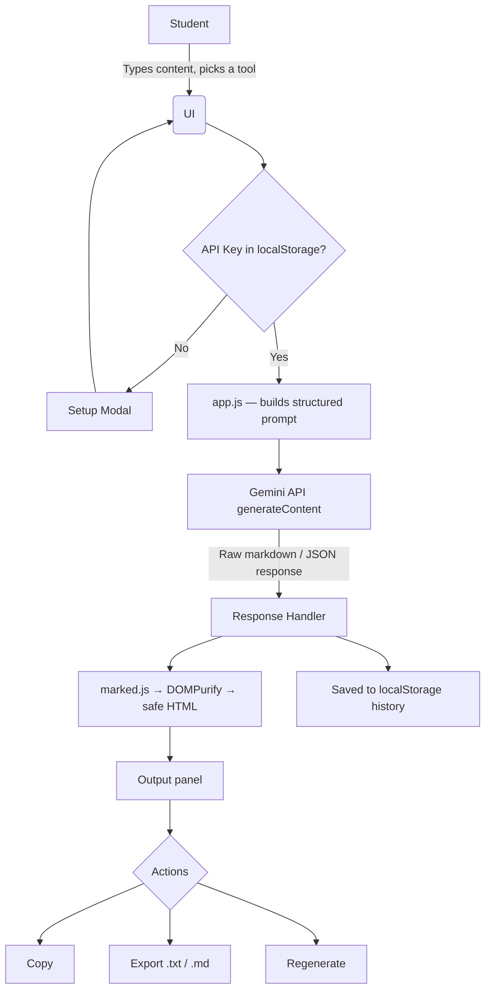

<div align="center">

# 🧠 StudyMind AI

### Your AI-powered study companion — summarize, explain, quiz, improve, plan, and memorize, all in one place.

[](#)
[](#)
[](#)
[](#)

<i>A completely client-side AI student assistant — no build step, no framework, no backend. Just open it and study smarter.</i>

**Built by [Akhilesh Kachhwaha](#)**

</div>

---

## 📋 Table of Contents

- [About](#-about)
- [Features](#-features)
- [What Makes This "Enhanced"](#-what-makes-this-enhanced)
- [Tech Stack](#-tech-stack)
- [Architecture](#-architecture)
- [Getting Started](#-getting-started)
- [Deploying It Live](#-deploying-it-live)
- [Project Structure](#-project-structure)
- [Security Note](#-security-note)
- [Screenshots](#-screenshots)
- [Roadmap](#-roadmap)
- [Credits](#-credits)

---

## 📖 About

**StudyMind AI** is a beginner-level AI Engineer Internship project (ShadowFox) built to demonstrate real, practical LLM API integration — not a generic chatbot, but a focused set of study tools that solve an actual student problem: turning raw, unstructured material (notes, rough answers, half-formed questions) into something study-ready in one click.

Every tool sends a **structured, purpose-built prompt** to Google's Gemini API — with a defined role, task, and output format — rather than forwarding the user's raw text. That's the core prompt-engineering demonstration behind this project.

---

## ✨ Features

| Tool | What it does |
|---|---|
| 📝 **Note Summarizer** | Condenses long, messy notes into clear, structured bullet points |
| 💡 **Concept Explainer** | Explains any topic at your chosen level — ELI5, Standard, or Advanced — with a real-world example |
| 🎯 **Quiz Generator** | Turns your notes into a 3-question multiple-choice quiz, with an answer key |
| ✍️ **Answer Improver** | Reviews a draft answer, gives feedback, and rewrites it clearly |
| 📅 **Schedule Maker** | Builds a realistic day-by-day or hour-by-hour study timetable from your topics and time constraints |
| 🗂️ **Flashcard Maker** | Generates 6 flip-style Q&A flashcards from any notes — click to flip |

**Plus:** dark/light theme, generation history with search + pin, one-click copy, export as `.txt` or `.md`, regenerate, keyboard shortcut (`Ctrl/Cmd + Enter`), and a configurable model selector.

---

## 🚀 What Makes This "Enhanced"

This project started from a solid beginner submission and was taken further in two directions: **a full visual redesign** and **six new features + real bug fixes**.

### 🎨 Redesigned, not just restyled
The original used a dark indigo/purple glassmorphism look. This version is a **neo-brutalist redesign**: bold 2.5px borders, hard offset drop-shadows instead of blur, a warm cream background with a subtle dot-grid, `Space Grotesk` display type, and six distinct accent colors — one per tool. The sidebar became a horizontal row of color-coded tiles that visually "press in" when selected. Dark mode is still available, now as a genuine alternate palette.

### 🆕 New capabilities
- Flashcard Maker (brand new tool)
- Difficulty levels for the Concept Explainer (ELI5 / Standard / Advanced)
- Settings drawer — API key, model selector, theme toggle, clear history, all in one place
- Configurable model — switch between Gemini models without touching code
- History search + pin
- Export as Markdown, alongside `.txt`
- Regenerate button + `Ctrl/Cmd + Enter` shortcut
- Toast notifications for errors/success
- Live character counter with minimum-length warning
- Mobile bottom navigation for small screens

### 🐛 Bugs fixed
- **XSS vulnerability patched** — AI output now passes through `DOMPurify.sanitize()` before touching the DOM, instead of raw `innerHTML`
- **Missing minimum-length validation** — inputs under 10 characters are now rejected with a clear message
- **Fragile error handling** — simplified to surface the API's actual error message reliably

---

## 🛠 Tech Stack

- **Frontend:** HTML5, CSS3, vanilla JavaScript — zero build step, zero dependencies to install
- **AI:** Google Gemini API (`generateContent`), called directly from the browser
- **Libraries (via CDN):** [`marked.js`](https://github.com/markedjs/marked) for markdown rendering, [`DOMPurify`](https://github.com/cure53/DOMPurify) for sanitizing that output, [Boxicons](https://boxicons.com/) for icons

---

## 🔄 Architecture



---

## ⚡ Getting Started

Because this is fully client-side, all you need is a local static server (opening `index.html` directly via `file://` won't work — the browser blocks the API request due to CORS).

```bash
# Clone or download this project, then from inside the folder:

# Option A — Python
python -m http.server 8000

# Option B — Node.js
npx serve .
```

Then open **http://localhost:8000** in your browser. On first load, you'll be asked for a Gemini API key — grab a free one at [Google AI Studio](https://aistudio.google.com/).

---

## 🌐 Deploying It Live

Since there's no backend, this deploys anywhere that serves static files — for free:

**GitHub Pages**
1. Push this folder to a new GitHub repository (must be public for the free tier).
2. Go to **Settings → Pages**, set branch to `main`, folder to `/ (root)`, save.
3. Your live link appears at `https://<your-username>.github.io/<repo-name>/` within a minute or two.

**Netlify (even faster)**
1. Go to [app.netlify.com/drop](https://app.netlify.com/drop).
2. Drag your project folder in.
3. Get an instant live URL — sign up (free) to keep it permanent.

---

## 📁 Project Structure

```
study-ai-pro-enhanced/
├── index.html      # markup — layout, modals, settings drawer
├── style.css       # neo-brutalist design system, light/dark themes
├── app.js          # all app logic — prompts, API calls, history, validation
└── README.md
```

---

## 🔐 Security Note

This is a **Bring-Your-Own-Key (BYOK)** app: your Gemini API key lives in your browser's `localStorage` and is sent directly to Google with each request — it never touches any third-party server. That said, since the key stays client-side, it's visible to anyone with access to that browser's DevTools. This is an accepted trade-off of the no-backend architecture and is fine for personal/local use or a portfolio demo. For a production deployment handling other people's keys, the next step would be a thin backend proxy that holds the key server-side instead.

---

## 📸 Screenshots

*(Add screenshots here after deploying — e.g. `screenshots/summarizer.png`, `screenshots/flashcards.png`, `screenshots/dark-mode.png`)*

---

## 🗺 Roadmap

- [ ] Optional backend proxy mode for secure key handling
- [ ] PDF export for summaries and quizzes
- [ ] Streaming responses instead of a single-shot request
- [ ] Adjustable quiz length and flashcard count
- [ ] Import notes directly from a `.txt`/`.md` file

---

<div align="center">

## 👤 Credits

**Built by Akhilesh Kachhwaha**

*ShadowFox AI Engineer Internship — Beginner Level Task*

</div>
